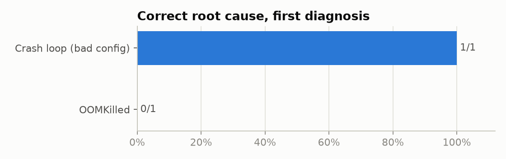
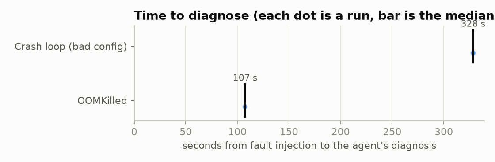
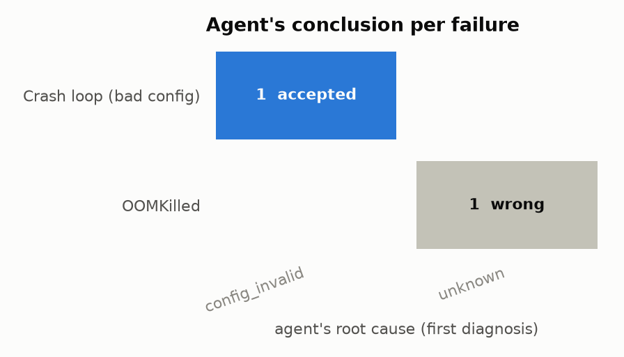
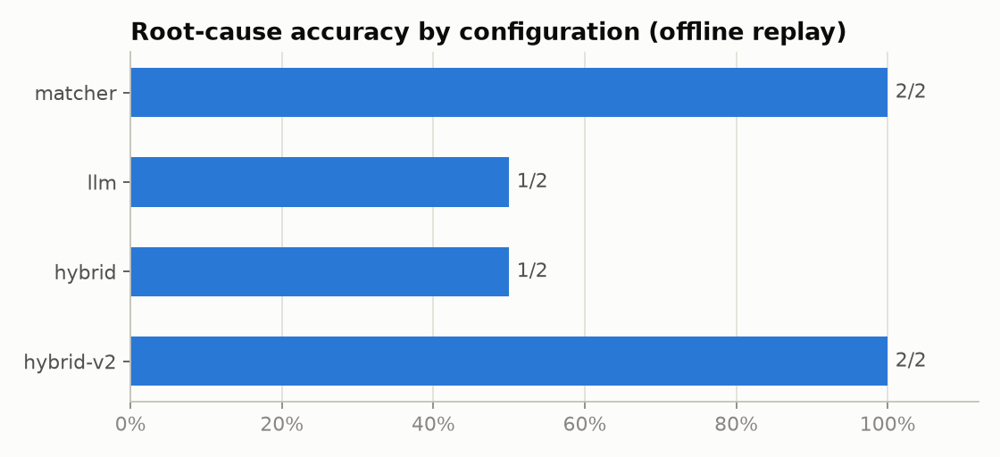

# Eval results: phase6-v1

Generated by `make report`; do not edit by hand. Analysis: [docs/evals.md](../../evals.md).

2 chaos runs, agent in dry-run mode (it diagnosed and proposed; nothing ran).
Root cause correct in 1/2 graded runs (50%); unsafe actions: 0.

| Scenario                |   Runs | RCA correct   | Exact cause   | Top 2   | Right action   | Median time to detect   | Median time to diagnose   | Manual time   | Alerts → incidents   |   Unsafe actions |
|:------------------------|-------:|:--------------|:--------------|:--------|:---------------|:------------------------|:--------------------------|:--------------|:---------------------|-----------------:|
| Crash loop (bad config) |      1 | 1/1           | 0/1           | 1/1     | 1/1            | 262 s                   | 328 s                     | -             | 1 → 1                |                0 |
| OOMKilled               |      1 | 0/1           | 0/1           | 1/1     | 0/1            | 52 s                    | 107 s                     | -             | 2 → 1                |                0 |

## Diagnosis source and cost

| source   |   runs |   median_input_tokens |   median_output_tokens |   median_llm_ms |
|:---------|-------:|----------------------:|-----------------------:|----------------:|
| llm      |      2 |                  1577 |                  174.5 |           34604 |

## Configurations, replayed offline on the same evidence

| Configuration   |   Replays | RCA correct   | Exact cause   | Right action   |   Fell back to matcher |   Median input tokens |
|:----------------|----------:|:--------------|:--------------|:---------------|-----------------------:|----------------------:|
| matcher         |         2 | 2/2           | 2/2           | 2/2            |                      0 |                     0 |
| llm             |         2 | 1/2           | 0/2           | 1/2            |                      0 |                  1533 |
| hybrid          |         2 | 1/2           | 1/2           | 1/2            |                      0 |                  1577 |
| hybrid-v2       |         2 | 2/2           | 2/2           | 2/2            |                      0 |                  1701 |

|                         | hybrid   | hybrid-v2   | llm   | matcher   |
|:------------------------|:---------|:------------|:------|:----------|
| Crash loop (bad config) | 1/1      | 1/1         | 1/1   | 1/1       |
| OOMKilled               | 0/1      | 1/1         | 0/1   | 1/1       |

